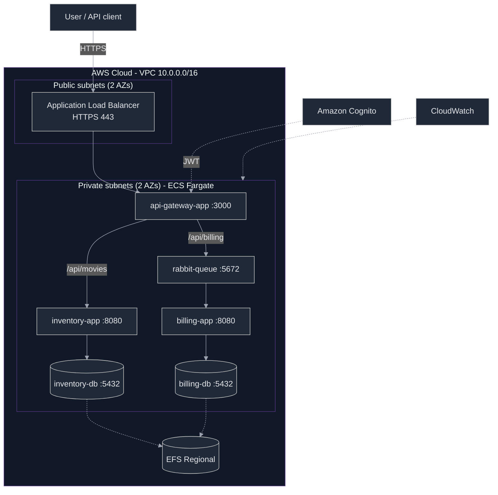

# Cloud-Design

Design, deploy and operate a cloud-based microservices application on AWS using
Terraform (Infrastructure as Code), Docker and AWS ECS Fargate.

The application is the microservices stack from the previous projects
(`crud-master`, `play-with-containers`, `orchestrator`): an API gateway, an
inventory service with a PostgreSQL database, a billing service with a
PostgreSQL database, and a RabbitMQ queue.

---

## Architecture



### Components

| Component | Image | Port | Description |
|-----------|-------|------|-------------|
| api-gateway-app | `docker.io/1ee5lim/api-gateway-app` | 3000 | Public entry point; validates the Cognito JWT and proxies to services |
| inventory-app | `docker.io/1ee5lim/inventory-app` | 8080 | Movie inventory service (PostgreSQL) |
| billing-app | `docker.io/1ee5lim/billing-app` | 8080 | Consumes billing messages from RabbitMQ (PostgreSQL) |
| rabbit-queue | `docker.io/oriax11/rabbit-queue` | 5672/15672 | Message broker |
| inventory-db | `docker.io/oriax11/inventory-db` | 5432 | PostgreSQL for inventory |
| billing-db | `docker.io/oriax11/billing-db` | 5432 | PostgreSQL for billing |

### AWS services used

- **Networking:** VPC, 2 public + 2 private subnets across 2 AZs, Internet
  Gateway, single NAT Gateway, route tables, security groups.
- **Compute:** ECS on **Fargate** (serverless containers, `awsvpc` networking).
- **Service discovery:** ECS Service Connect.
- **Storage:** EFS Regional (persistent PostgreSQL data, one access point per DB).
- **Load balancing / TLS:** Application Load Balancer + ACM (self-signed cert).
- **Auth:** Amazon Cognito user pool (JWT, RS256).
- **Secrets:** AWS Secrets Manager.
- **Monitoring:** CloudWatch Logs, Container Insights, dashboard.
- **Registry:** Docker Hub (public images).

---

## Repository structure

```
cloud-design/
├── README.md
├── docs/                       # subject, audit, architecture + status documents
├── srcs/                       # microservice source code
│   ├── api-gateway-app/        # Flask gateway (proxy + queue publisher)
│   ├── inventory-app/          # Flask inventory API (SQLAlchemy)
│   ├── billing-app/            # Flask/RabbitMQ billing consumer
│   ├── postgres-db/            # PostgreSQL init tooling
│   └── rabbitmq/               # RabbitMQ init tooling
├── docker/
│   ├── api-gateway-app/Dockerfile
│   ├── inventory-app/Dockerfile
│   ├── billing-app/Dockerfile
│   ├── inventory-db/Dockerfile
│   ├── billing-db/Dockerfile
│   ├── rabbit-queue/Dockerfile
│   ├── docker-compose.yml
│   └── .env.example
├── ecs/
│   └── task-definitions/       # exported ECS task definitions (reference)
├── monitoring/
│   ├── cloudwatch-dashboard.json
│   ├── trivy-scan.txt          # Trivy vulnerability scan evidence
│   └── load-test.txt           # load-test + autoscaling evidence
├── terraform/
│   ├── provider.tf
│   ├── variables.tf
│   ├── outputs.tf
│   ├── budget.tf               # AWS Budget cost alerts
│   ├── main.tf                 # module wiring + state migrations (`moved`)
│   └── modules/
│       ├── vpc/                # VPC, subnets, IGW, NAT, route tables
│       ├── security/           # security groups
│       ├── efs/                # EFS file systems, mount targets, access points
│       ├── alb/                # ALB, listeners, ACM self-signed certificate
│       └── ecs/                # ECS cluster/services, IAM, secrets, Cognito, CloudWatch
└── scripts/
    ├── bootstrap-iam.sh        # create/cleanup the deployer IAM user
    ├── create-test-user.sh     # create a Cognito test user and print a token
    ├── build-push.sh           # build + push images to Docker Hub
    ├── scan.sh                 # Trivy vulnerability scan
    ├── load-test.sh            # concurrent load generator
    ├── deploy.sh               # terraform init/fmt/validate/plan
    └── cleanup.sh              # terraform destroy
```

---

## Prerequisites

- An AWS account and an IAM user with permission to create the resources
  (AdministratorAccess is sufficient for this learning project).
- [Terraform](https://developer.hashicorp.com/terraform) >= 1.9
- [AWS CLI v2](https://docs.aws.amazon.com/cli/latest/userguide/getting-started-install.html)
- `openssl` (used by the test-user script)
- Docker (optional, for local development)

---

## Configuration

Create `terraform.tfvars` from the example and fill in the credentials:

```hcl
inventory_db_user     = "inventory_user"
inventory_db_password = "change-me"
inventory_db_name     = "inventory"

billing_db_user     = "billing_user"
billing_db_password = "change-me"
billing_db_name     = "billing"

rabbitmq_user     = "rabbit_user"
rabbitmq_password = "change-me"
rabbitmq_queue    = "billing_queue"
```

These values are stored in AWS Secrets Manager and injected into the tasks.

> `terraform.tfvars` is gitignored. Never commit real credentials.

---

## Deploy

```bash
# 1. Authenticate (or use scripts/bootstrap-iam.sh to create a deployer user)
aws sts get-caller-identity

# 2. Provision the infrastructure (Terraform lives in terraform/)
cd terraform
terraform init
terraform plan
terraform apply
cd ..

# 3. Create a Cognito test user and get a JWT
./scripts/create-test-user.sh \
  "$(cd terraform && terraform state show 'module.ecs.aws_cognito_user_pool.main' | awk '$1=="id"{print $3}' | tr -d '"')" \
  "$(cd terraform && terraform state show 'module.ecs.aws_cognito_user_pool_client.app' | awk '$1=="id"{print $3}' | tr -d '"')"
```

Useful outputs:

```bash
cd terraform
terraform output -raw alb_dns_name      # ALB DNS name
terraform output -raw app_url_https     # https://<alb>
terraform output -raw acm_certificate_arn
```

---

## Usage

The API is served over HTTPS with a **self-signed** certificate, so use `curl -k`.

```bash
ALB=$(cd terraform && terraform output -raw alb_dns_name)

# Public liveness / status page
curl -k https://$ALB/

# Obtain a Cognito IdToken (see scripts/create-test-user.sh)
TOKEN=...

# Inventory API (protected)
curl -k -H "Authorization: Bearer $TOKEN" https://$ALB/api/movies

curl -k -X POST -H "Authorization: Bearer $TOKEN" -H 'Content-Type: application/json' \
  -d '{"title":"Dune","description":"Desert","release_year":2021,"genre":"Sci-Fi"}' \
  https://$ALB/api/movies

# Billing (published to RabbitMQ; the schema is {user_id, number_of_items, total_amount})
curl -k -X POST -H "Authorization: Bearer $TOKEN" -H 'Content-Type: application/json' \
  -d '{"user_id":42,"number_of_items":5,"total_amount":99.99}' \
  https://$ALB/api/billing/
```

Requests without a valid token get `401 Unauthorized`.

---

## Security

| Layer | Control |
|-------|---------|
| Edge | ALB HTTPS (`:443`), HTTP → HTTPS redirect, ACM certificate |
| Authentication | Cognito user pool; the gateway validates the RS256 JWT against the pool JWKS |
| Network | All containers in private subnets, no public IPs; security groups are service-to-service |
| Secrets | Secrets Manager (no credentials in the image or in task env) |
| Data at rest | EFS encryption |
| Image scanning | Use Trivy locally before pushing images (`trivy image --severity HIGH,CRITICAL <image>`) |

---

## Monitoring and logging

- Every task ships logs to **CloudWatch Logs** (`/ecs/cloud-design-*`).
- **Container Insights** is enabled on the cluster.
- A CloudWatch dashboard (`cloud-design`) shows per-service CPU/memory, ALB
  request count, response time and 5XX, and running task counts.

## Auto-scaling

Stateless services scale on average CPU (target 70%, min 2 / max 4):
`api-gateway`, `inventory-app`, `billing-app`. Stateful services
(`rabbit-queue`, both databases) stay at 1 task.

---

## Cost (approximate, 15 days)

| Item | Est. |
|------|------|
| Fargate (9 tasks) | ~$42 |
| ALB + LCU | ~$10 |
| NAT Gateway | ~$16 |
| EFS | ~$1 |
| Misc | ~$1 |
| **Total** | **~$70** |

Destroy the stack when you are done to stop billing.

## Cleanup

```bash
./scripts/cleanup.sh
# then remove the deployer access key / IAM user:
./scripts/bootstrap-iam.sh --cleanup cloud-design-deployer
```

---

## Known issues / notes

- **Application images** are published under `1ee5lim/*` and include the fixes
  directly (hop-by-hop header stripping, `/` route, Cognito JWT enforcement on
  `/api/*`, and SQLAlchemy `pool_pre_ping`/`pool_recycle`). No runtime patches
  are required.
- The TLS certificate is self-signed (no owned domain for ACM validation);
  browsers will warn. Use `curl -k`.
- The database and RabbitMQ images (`oriax11/*`) are built on
  `debian:bookworm` and carry a base-image vulnerability backlog (see
  `monitoring/trivy-scan.txt`: 17 CRITICAL / 94 HIGH each). Rebuild them on a
  maintained minimal base (e.g. `postgres:15-alpine`) to clear it.

## Local development (Docker Compose)

`docker/docker-compose.yml` mirrors the AWS topology on one host:

```bash
cd docker
cp .env.example .env      # fill in the credentials
docker compose up --build
# api-gateway-app is published on :${APIGATEWAY_PORT:-3000}
```
