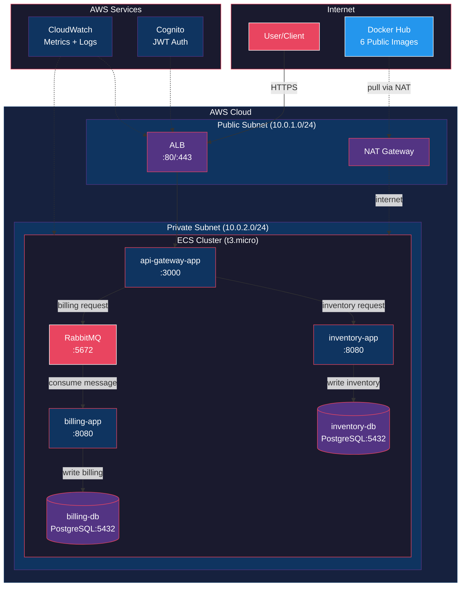
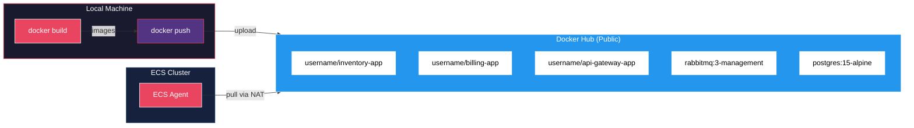
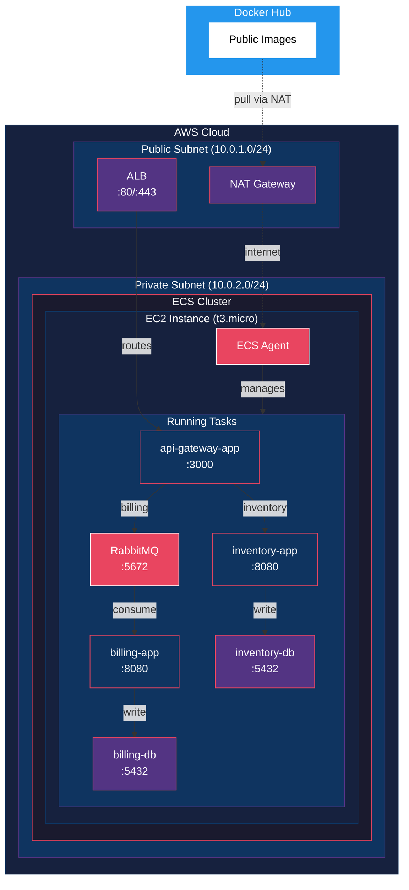
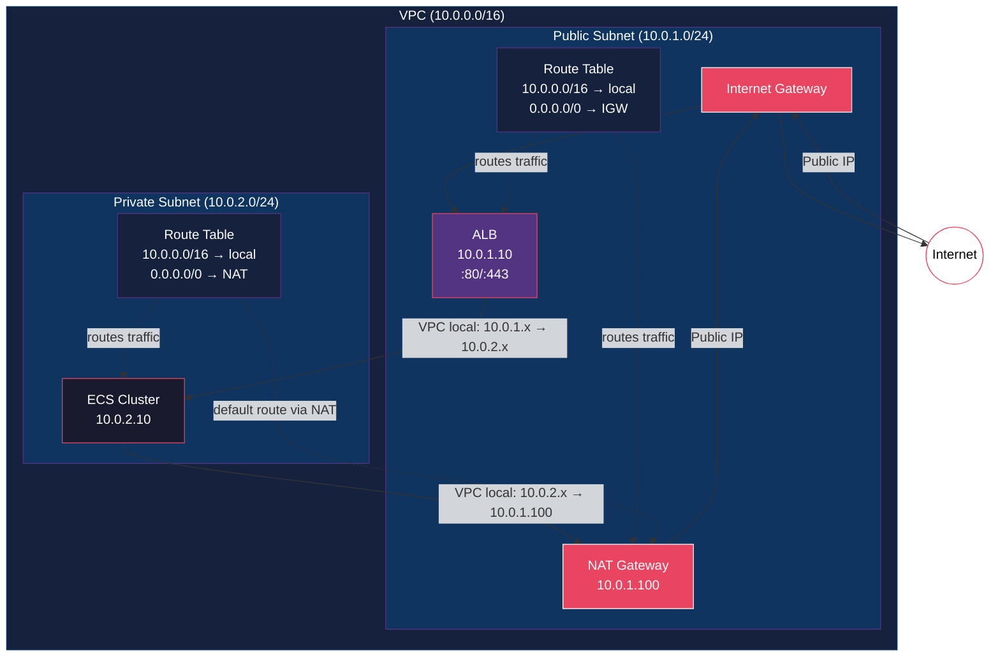

# Cloud-Design Architecture Plan

## Overview

This document outlines the detailed 15-day implementation plan for the Cloud-Design project, aligned with both the project specification and audit requirements.

---

## Budget Breakdown (15 Days)

| Resource | Instance | Hourly Rate | 15 Days (360h) | Total |
|----------|----------|-------------|-----------------|-------|
| ECS EC2 | t3.micro | $0.0104 | $3.75 | **$3.75** |
| ALB | - | $0.0225 | $8.10 | **$9.00** |
| NAT Gateway | - | $0.045 | $16.20 | **$16.20** |
| CloudWatch | Free tier | $0 | $0 | **$0** |
| Docker Hub | Free tier | $0 | $0 | **$0** |
| **Total** | | | | **~$28.95** |
| **Remaining** | | | | **~$71.05** |

> **Note:** All 6 containers (including databases) run as Docker images in ECS.
> Images stored on Docker Hub (free public repos). No RDS — databases run as PostgreSQL containers with EBS volumes for persistence.

---

## Architecture Diagram (1 AZ - 6 Containers)



### Data Flow

```
1. User → ALB (443/HTTPS) → api-gateway (3000)
2. api-gateway → inventory-app (8080) [inventory operations]
3. api-gateway → RabbitMQ (5672) [billing request]
4. RabbitMQ → billing-app (8080) [consumer processes message]
5. billing-app → billing-db (5432) [write billing record]
6. inventory-app → inventory-db (5432) [write inventory]
7. NAT Gateway → internet access for private subnet (pull from ECR)
```

### Container Inventory

| Container | Image | Port | Description |
|-----------|-------|------|-------------|
| api-gateway-app | username/api-gateway-app | 3000 | Routes requests to services |
| inventory-app | username/inventory-app | 8080 | Handles inventory operations |
| billing-app | username/billing-app | 8080 | Processes billing via RabbitMQ |
| rabbit-queue | rabbitmq:3-management | 5672 | Message queue for async |
| inventory-db | postgres:15-alpine | 5432 | PostgreSQL inventory data |
| billing-db | postgres:15-alpine | 5432 | PostgreSQL billing data |

> Replace `username` with your Docker Hub username in all task definitions.

---

## Docker Hub Flow Diagram



---

## ECS Cluster Diagram



---

## VPC Networking Diagram



### How Subnets Link

| Path | Route | Example |
|------|-------|---------|
| **Public ↔ Private** | VPC local route (10.0.0.0/16) | ALB (10.0.1.10) → ECS (10.0.2.10) |
| **Private → Internet** | 0.0.0.0/0 → NAT Gateway | ECS pulls from Docker Hub |
| **Internet → Public** | 0.0.0.0/0 → Internet Gateway | User accesses ALB |
| **Container ↔ Container** | VPC local route (same subnet) | ECS → ECS (10.0.2.x ↔ 10.0.2.x) |

### Key Security Points

- **Private subnet has no public IPs** — containers cannot be accessed from internet
- **NAT Gateway only allows outbound** — no inbound connections to private subnet
- **Security groups** — restrict traffic on specific ports (8080, 5432, 5672, etc.)
- **ALB terminates HTTPS** — handles SSL/TLS, forwards HTTP to containers

---

## Day-by-Day Implementation Plan

### Days 1-2: Foundation & AWS Setup

**Goal:** Account ready, tools installed, repo structured

**Tasks:**
- Create AWS account, set up IAM user with admin access
- Install: AWS CLI, Terraform, Docker
- Configure billing alerts ($50, $75, $90 thresholds)
- Create repository structure

**Repository Structure:**
```
cloud-design/
├── README.md
├── terraform/
│   ├── main.tf
│   ├── variables.tf
│   ├── outputs.tf
│   ├── provider.tf
│   └── modules/
│       ├── vpc/
│       ├── ecs/
│       ├── alb/
│       └── security/
├── docker/
│   ├── inventory-app/
│   │   └── Dockerfile
│   ├── billing-app/
│   │   └── Dockerfile
│   ├── api-gateway-app/
│   │   └── Dockerfile
│   ├── inventory-db/
│   │   └── Dockerfile
│   ├── billing-db/
│   │   └── Dockerfile
│   └── docker-compose.yml
├── ecs/
│   ├── task-definitions/
│   │   ├── inventory-app.json
│   │   ├── billing-app.json
│   │   ├── api-gateway-app.json
│   │   ├── rabbit-queue.json
│   │   ├── inventory-db.json
│   │   └── billing-db.json
│   ├── services/
│   └── cluster-config.json
├── monitoring/
│   └── cloudwatch-dashboard.json
└── scripts/
    ├── deploy.sh
    └── cleanup.sh
```

**Audit check:** ✅ Files present in repo

---

### Days 3-4: VPC & Networking (Terraform)

**Goal:** Isolated network with public/private subnets (1 AZ)

**Terraform Configuration:**
```hcl
# terraform/modules/vpc/
- VPC (10.0.0.0/16)
- 1 Public subnet (10.0.1.0/24) - ALB, NAT Gateway
- 1 Private subnet (10.0.2.0/24) - ECS (all 6 containers)
- Internet Gateway
- NAT Gateway (single, for cost)
- Route tables
- Security groups:
  - alb-sg: 80, 443 from 0.0.0.0/0
  - ecs-sg: 8080, 3000, 5672, 5432 from alb-sg only
```

**Audit check:** ✅ VPC isolation, databases only accessible from VPC

---

### Days 5-6: Build & Push to Docker Hub

**Goal:** Build optimized images and push to Docker Hub

**Tasks:**
1. Build all 6 Docker images locally
2. Test with docker-compose.yml
3. Tag and push to Docker Hub

**Push Commands:**
```bash
# Login
docker login

# Build and push (repeat for each)
docker build -t username/inventory-app:latest ./docker/inventory-app/
docker push username/inventory-app:latest

docker build -t username/billing-app:latest ./docker/billing-app/
docker push username/billing-app:latest

docker build -t username/api-gateway-app:latest ./docker/api-gateway-app/
docker push username/api-gateway-app:latest

# For databases, build custom Dockerfiles or use official images
docker build -t username/inventory-db:latest ./docker/inventory-db/
docker push username/inventory-db:latest

docker build -t username/billing-db:latest ./docker/billing-db/
docker push username/billing-db:latest
```

**Audit check:** ✅ All 6 images on Docker Hub, optimized Dockerfiles

---

### Days 7-8: Containerize Microservices

**Goal:** Optimized Docker images

**Dockerfile Example (Multi-stage, Alpine):**
```dockerfile
# inventory-app/Dockerfile
FROM node:18-alpine AS builder
WORKDIR /app
COPY package*.json ./
RUN npm ci --only=production
COPY . .
RUN npm run build

FROM node:18-alpine
WORKDIR /app
COPY --from=builder /app/dist ./dist
COPY --from=builder /app/node_modules ./node_modules
EXPOSE 8080
CMD ["node", "dist/index.js"]
```

**Tasks:**
- Build all 3 app images locally
- Test with docker-compose.yml
- Create ECR repositories, push images

**Audit check:** ✅ Optimized Dockerfiles, build times reduced

---

### Days 9-10: ECS Cluster & Services

**Goal:** All 6 containers running on ECS

**Terraform Configuration:**
```hcl
# terraform/modules/ecs/
- ECS Cluster
- EC2 instances (t3.micro, 2x for HA)
- IAM roles for ECS
- CloudWatch agent
```

**Task Definitions (6 total):**
1. `inventory-app`: port 8080, connects to inventory-db
2. `billing-app`: port 8080, connects to billing-db + rabbit-queue
3. `api-gateway-app`: port 3000, forwards to inventory-app/billing-app
4. `rabbit-queue`: port 5672/15672
5. `inventory-db`: PostgreSQL on port 5432, EBS volume for data
6. `billing-db`: PostgreSQL on port 5432, EBS volume for data

**Services:**
- `api-gateway`: behind ALB (public, port 3000)
- `inventory-app`: internal
- `billing-app`: internal
- `rabbit-queue`: internal
- `inventory-db`: internal, EBS volume mounted
- `billing-db`: internal, EBS volume mounted

**Audit check:** ✅ `aws ecs list-services`, `docker ps` shows all 6 running

---

### Day 11: ALB & Load Balancing

**Goal:** Traffic distribution + HTTPS

**Terraform Configuration:**
```hcl
# terraform/modules/alb/
- Application Load Balancer
- Target group for api-gateway (port 3000)
- Listener on port 443 (HTTPS)
- ACM certificate (free)
- Redirect HTTP → HTTPS
```

**Audit check:** ✅ Load balancing configured, HTTPS

---

### Day 12: Security & Cognito

**Goal:** Authentication + access control

**Terraform Configuration:**
```hcl
# Cognito User Pool
- User pool for API authentication
- App client for api-gateway
- JWT authorizer on ALB listener rules
```

**Test:**
- Request without auth → rejected (401)
- Request with valid JWT → allowed

**Audit check:** ✅ Unauthenticated requests rejected, Cognito configured

---

### Day 13: Monitoring & Auto-scaling

**Goal:** Observability + scaling

**CloudWatch Dashboard (JSON):**
- ECS CPU/Memory utilization
- RDS connections, query latency
- ALB request count, latency
- RabbitMQ queue depth

**Auto-scaling:**
- ECS Service: min=1, max=3, target CPU 70%
- EC2 Auto Scaling Group: min=2, max=4

**Test:** Send load, verify scaling triggers

**Audit check:** ✅ Dashboards visible, auto-scaling works

---

### Day 14: API Testing & Billing Resilience

**Goal:** Verify functionality + queue resilience

**Test Sequence:**
1. POST /movies through api-gateway → 201 Created
2. GET /movies through api-gateway → list of movies
3. Stop billing-app: `aws ecs update-service --desired-count 0`
4. Send billing request → should succeed (queued in RabbitMQ)
5. Restart billing-app: `aws ecs update-service --desired-count 1`
6. Verify billing-app processed queued request

**Audit check:** ✅ API Gateway works, billing resilience demonstrated

---

### Day 15: Documentation & Final Prep

**Goal:** README.md + audit readiness

**README.md Structure:**
```
# Cloud-Design

## Architecture
[Mermaid diagram]

## Components (6 Containers)
- api-gateway-app: Routes requests (port 3000)
- inventory-app: Handles inventory operations (port 8080)
- billing-app: Processes billing via RabbitMQ (port 8080)
- rabbit-queue: Message queue for async processing (port 5672)
- inventory-db: PostgreSQL database (port 5432)
- billing-db: PostgreSQL database (port 5432)

## Prerequisites
- AWS account with CLI configured
- Terraform installed
- Docker installed
- Docker Hub account

## Setup
1. Clone repo
2. cd terraform && terraform init && terraform apply
3. Build and push 6 Docker images to Docker Hub
4. Deploy ECS services

## Security
- HTTPS via ACM + ALB
- Cognito for API authentication
- All containers in private subnet

## Monitoring
- CloudWatch dashboard for metrics
- Centralized logging

## Cost Breakdown
- Total: ~$29 for 15 days
```

**Audit Prep:**
- Practice 13 role-play questions
- Prepare `terraform plan`/`apply` demo
- Test all `aws ecs` commands
- Verify `docker ps` locally

**Audit check:** ✅ Documentation complete, audit ready

---

## Audit Compliance Summary

| Audit Item | How We Meet It |
|------------|----------------|
| Repository files | ✅ All files present |
| Role-play (13 Qs) | ✅ Study sessions on Days 14-15 |
| Architecture (5 criteria) | ✅ Documented in README |
| README completeness | ✅ Diagrams, setup, config, usage |
| Deployment verification | ✅ `aws ecs` commands + `docker ps` |
| API Gateway POST/GET | ✅ Day 14 testing |
| Billing resilience | ✅ Day 14 testing |
| Terraform | ✅ All infra in code |
| Optimized Dockerfiles | ✅ Multi-stage builds |
| Monitoring dashboards | ✅ CloudWatch |
| Auto-scaling | ✅ ECS Service Auto Scaling |
| Security: HTTPS | ✅ ACM + ALB |
| Security: Cognito | ✅ Day 12 |
| Security: VPC | ✅ RDS in private subnets |

---

## Cost Efficiency Summary

- **ECS over EKS:** Saves $36 (no control plane)
- **EC2 over Fargate:** Saves ~$100+ (no per-second pricing)
- **Single NAT Gateway:** Saves ~$16 vs two
- **db.t3.micro:** Smallest RDS instance
- **CloudWatch free tier:** No extra monitoring cost

**Total: ~$41 for 15 days, well within $100 budget.**

---

## Next Steps

1. Start with Days 1-2: Foundation & AWS Setup
2. Proceed through each phase sequentially
3. Test at each phase before moving to next
4. Document as you go (easier than at the end)
