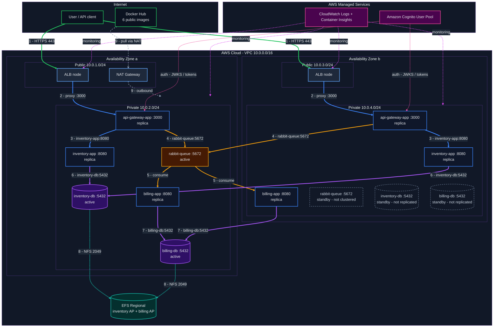
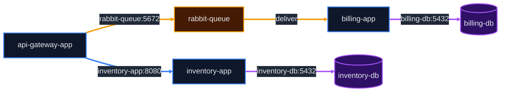
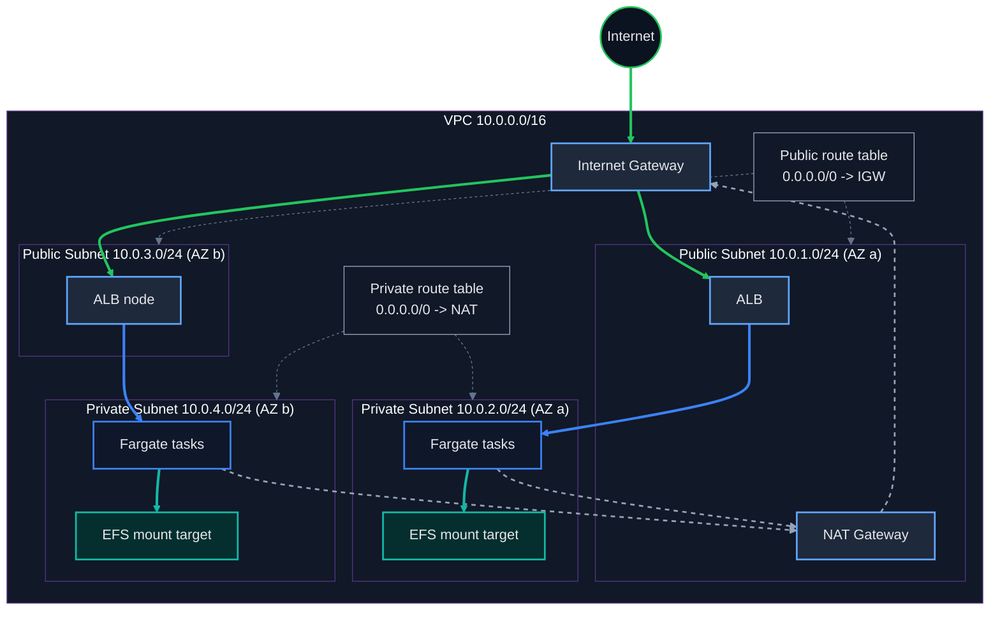

# Cloud-Design Architecture Plan

## Overview

This document is the detailed 15-day implementation plan for the Cloud-Design
project, aligned with both the project specification and the audit requirements.

**Fixed decisions:**

| Area | Decision |
|------|----------|
| Orchestration | AWS ECS on **Fargate** (no EC2 instances) |
| Registry | **Docker Hub** (no ECR) |
| Databases | **PostgreSQL containers** (no RDS) |
| Persistence | **EFS Regional** + one access point per database |
| Availability | **2 Availability Zones**, single NAT Gateway |
| HA model | **Hybrid:** stateless services active-active across AZs; stateful services (Postgres, RabbitMQ) single-active |
| HTTPS | **Self-signed certificate imported into ACM** |
| Authentication | **Amazon Cognito** JWTs, enforced at api-gateway-app |
| Scanning | **Trivy** on images before push |

---

## Budget Breakdown (~15 Days)

| Resource | Tasks | Sizing | Hourly | 15 Days (360 h) |
|----------|-------|--------|--------|------------------|
| api-gateway-app | 2 (1/AZ) | 0.25 vCPU / 0.5 GB | $0.01234 | **$8.89** |
| inventory-app | 2 (1/AZ) | 0.25 vCPU / 0.5 GB | $0.01234 | **$8.89** |
| billing-app | 2 (1/AZ) | 0.25 vCPU / 0.5 GB | $0.01234 | **$8.89** |
| rabbit-queue | 1 (AZ a) | 0.25 vCPU / 1 GB | $0.01457 | **$5.24** |
| inventory-db | 1 (AZ a) | 0.25 vCPU / 1 GB | $0.01457 | **$5.24** |
| billing-db | 1 (AZ a) | 0.25 vCPU / 1 GB | $0.01457 | **$5.24** |
| Fargate subtotal | 9 tasks | | | **$42.39** |
| ALB + small LCU | — | — | $0.0225 | **$10.00** |
| NAT Gateway + data | — | — | $0.045 | **$16.50** |
| EFS Regional (~2 GB, 2 APs) | — | $0.30/GB-month | — | **$1.00** |
| Data egress / misc | — | — | — | **$1.00** |
| **Total** | | | | **~$70.89** |
| **Remaining (of ~$75)** | | | | **~$4.11** |

> **Notes:**
> - All six components, including the databases, run as Fargate tasks.
> - **Stateless services** (api-gateway-app, inventory-app, billing-app) run
>   **2 replicas each, one per AZ** (active-active).
> - **Stateful services** (rabbit-queue, inventory-db, billing-db) run a
>   **single active task** in AZ a. The AZ b boxes are standby placeholders for
>   layout symmetry and are **not replicated** (see the Availability section for
>   the RTO/RPO tradeoff).
> - Fargate task storage is ephemeral; PostgreSQL data is persisted on EFS.
> - Postgres and RabbitMQ run at 0.25 vCPU / 1 GB. If local testing shows
>   memory pressure, raise only the DB tasks to 0.5 vCPU / 1 GB (+~$13 for 15
>   days) — prefer keeping them at 1 GB to stay within the ~$75 ceiling.
> - Prices are approximate `us-east-1` on-demand rates.

---

## Architecture Diagram



### Diagram Legend

**Different parts (node / box colours):**

| Colour | Hex | Part |
|--------|-----|------|
| 🟩 Green | `#22c55e` | External / Internet — user client and Docker Hub |
| 🟦 Blue | `#60a5fa` | Public subnet edge tier — ALB nodes and NAT Gateway |
| 🔵 Blue | `#3b82f6` | Private compute — api-gateway, inventory-app, billing-app (active-active replicas) |
| 🟧 Amber | `#f59e0b` | Messaging — rabbit-queue (single active broker) |
| 🟪 Purple | `#a855f7` | Databases — inventory-db, billing-db (single active writer) |
| ⬜ Slate dashed | `#64748b` | Standby — AZ b box shown for symmetry, **not replicated** (stateful) |
| 🟢 Teal | `#14b8a6` | Storage — EFS |
| 🩷 Pink | `#ec4899` | AWS managed services — CloudWatch, Cognito |

**Traffic flows (edge colours):**

| Colour | Hex | Traffic | Steps |
|--------|-----|---------|-------|
| 🟩 Green (thick) | `#22c55e` | External inbound HTTPS (to both ALB nodes) | 1: user -> ALB |
| 🔵 Blue (thick) | `#3b82f6` | Internal synchronous HTTP | 2–3: ALB -> gateway -> inventory |
| 🟧 Amber (thick) | `#f59e0b` | Asynchronous messaging | 4–5: gateway -> rabbit -> billing |
| 🟪 Purple (thick) | `#a855f7` | Database traffic (both gateway/inventory replicas -> single DB) | 6–7: app -> db |
| 🟢 Teal (dashed) | `#14b8a6` | Storage / NFS | 8: db -> EFS |
| ⬜ Gray (dashed) | `#94a3b8` | Outbound / image pulls | 9: Docker Hub -> NAT -> private |
| 🩷 Pink | `#ec4899` | Auth control plane | Cognito -> gateways |
| 🟪 Magenta (dashed) | `#d946ef` | Monitoring control plane | CloudWatch -> tasks / ALB |

> The placement of services in AZ a / AZ b above is the intended steady state.
> Fargate spreads the **stateless replicas** across both AZs. The **stateful
> services** (rabbit-queue, inventory-db, billing-db) have a single active task
> in AZ a; the dashed AZ b boxes are standby placeholders and are **not
> replicated**. Service Connect resolves the service names to the active task
> regardless of which AZ a caller runs in.

### Data Flow

```
1. User -> ALB (443/HTTPS, self-signed cert) -> an api-gateway-app replica (AZ a or b)
2. api-gateway-app validates the Cognito Bearer JWT (401 if missing/invalid)
3. api-gateway-app -> inventory-app (8080)          [inventory / movie operations]
4. api-gateway-app -> rabbit-queue (5672)            [billing request, single active broker]
5. rabbit-queue -> billing-app (8080)                [either replica consumes the message]
6. billing-app -> billing-db (5432)                  [write billing record, single writer]
7. inventory-app -> inventory-db (5432)              [read/write inventory, single writer]
8. inventory-db / billing-db -> EFS (2049)           [persistent storage]
9. Private tasks -> NAT Gateway -> internet          [Docker Hub image pulls]
```

> Stateless request processing is active-active across AZs. All stateful
> traffic (messaging and database) converges on the single active task in
> AZ a.

### Container / Service Inventory

| Service | Image | Tasks | Task size | Port | Role |
|---------|-------|-------|-----------|------|------|
| api-gateway-app | `username/api-gateway-app:latest` | 2 (1/AZ) | 0.25 vCPU / 0.5 GB | 3000 | ALB target; validates Cognito JWT |
| inventory-app | `username/inventory-app:latest` | 2 (1/AZ) | 0.25 vCPU / 0.5 GB | 8080 | Inventory / movie operations |
| billing-app | `username/billing-app:latest` | 2 (1/AZ) | 0.25 vCPU / 0.5 GB | 8080 | Consumes messages from RabbitMQ |
| rabbit-queue | `rabbitmq:3-management` | 1 (AZ a) | 0.25 vCPU / 1 GB | 5672 / 15672 | Single active broker (no cluster) |
| inventory-db | `postgres:15-alpine` | 1 (AZ a) | 0.25 vCPU / 1 GB | 5432 | EFS `/inventory`; single writer |
| billing-db | `postgres:15-alpine` | 1 (AZ a) | 0.25 vCPU / 1 GB | 5432 | EFS `/billing`; single writer |

> Replace `username` with your Docker Hub username in all task definitions.
> **Total: 9 running tasks** (6 stateless replicas + 3 stateful actives).

---

## Service Discovery (ECS Service Connect)

Namespace: `cloud-design.local`.



> **Colours:** blue = internal HTTP, amber = messaging, purple = database.
> Same traffic legend as the architecture diagram above.

- Each ECS service registers in the Service Connect namespace.
- Callers use the service name as the DNS host; no hardcoded task IPs.
- Stateless services have two endpoints (one per AZ); the gateway/ALB can reach
  either replica.
- Stateful services (`rabbit-queue`, `inventory-db`, `billing-db`) resolve to
  the **single active task** in AZ a, so all stateful traffic is cross-AZ when
  the caller runs in AZ b.
- Traffic stays inside the VPC; no database or queue is publicly reachable.

---

## VPC Networking Diagram (2 AZs, single NAT)



> **Colours:** green = inbound internet, blue = public-to-private service
> traffic, gray = outbound via NAT, teal = EFS storage, slate dotted = route
> tables.

### How Subnets Link

| Path | Route | Example |
|------|-------|---------|
| Public to private | VPC local route (10.0.0.0/16) | ALB (10.0.1.x) -> task (10.0.2.x) |
| Private to internet | 0.0.0.0/0 -> NAT Gateway | Fargate pulls from Docker Hub |
| Internet to public | 0.0.0.0/0 -> Internet Gateway | User accesses ALB |
| Task to task | Service Connect / VPC local | api-gateway -> inventory-app:8080 |
| Task to EFS | VPC local, port 2049 | DB task -> EFS mount target |

### Key Security Points

- **Private subnets have no public IPs** — tasks are not reachable from the internet.
- **NAT Gateway is outbound-only** — no inbound path to private tasks.
- **Security groups** restrict traffic:
  - `alb-sg`: ingress 80/443 from `0.0.0.0/0`; egress to `ecs-sg`.
  - `ecs-sg`: ingress from `alb-sg` on 3000; ingress self-referencing for
    Service Connect; egress to `efs-sg` on 2049 and to the internet via NAT.
  - `efs-sg`: ingress 2049 from `ecs-sg` only.
- **ALB terminates HTTPS** — handles TLS, redirects HTTP to HTTPS.

---

## Persistence (EFS)

- One **EFS Regional** file system (encrypted at rest).
- Mount target in each private subnet (AZ a and AZ b).
- Two access points:
  - `/inventory` — POSIX UID/GID `999`, permissions `0755`.
  - `/billing` — POSIX UID/GID `999`, permissions `0755`.
- Mounted at `/var/lib/postgresql/data` in each DB task.
- **Single writer per database.** No Postgres replication and no RabbitMQ
  cluster; the standby boxes in AZ b are placeholders (see Availability).
- EFS security group allows port 2049 only from `ecs-sg`.

---

## Availability (Hybrid HA Model)

| Tier | Services | Model | Behavior on AZ failure |
|------|----------|-------|------------------------|
| Stateless | api-gateway-app, inventory-app, billing-app | Active-active, 2 replicas (1/AZ) | Survives — ALB shifts traffic to the surviving replica |
| Stateful | rabbit-queue, inventory-db, billing-db | Single active (AZ a) | Degraded — no live copy; recovery is manual |

**Honest tradeoff (documented for the audit/role-play):**

- **RPO / RTO:** because stateful services are not replicated, data recovery
  point is the last EFS state and recovery time is a task relaunch/restore, not
  an instant promotion.
- **Why not full replication now:** real Postgres streaming replication
  (separate EFS access points + `pg_basebackup` + failover) and a RabbitMQ
  quorum cluster add days of fiddly setup and are not production-recommended on
  EFS/NFS. Given the 15-day timeline and simplicity requirement, the hybrid
  model keeps the HA story strong for the request-serving tier while being
  explicit about the stateful tier.
- **Future improvement:** move the databases to RDS Multi-AZ (or add Postgres
  streaming replication with per-instance storage), and run RabbitMQ as a
  quorum cluster.

---

## Security

| Layer | Control |
|-------|---------|
| Edge | ALB HTTPS listener, HTTP -> HTTPS redirect, self-signed cert imported into ACM |
| Authentication | Cognito user pool + app client; api-gateway validates Bearer JWT, returns 401 otherwise |
| Network | Private subnets, security groups, outbound-only NAT |
| Data at rest | EFS encryption at rest |
| Data in transit | TLS viewer->ALB; VPC-internal Service Connect |
| Scanning | Trivy `HIGH,CRITICAL` image scan before push |

### Cognito + Gateway Flow

1. Create a user pool and app client (no client secret for CLI demo).
2. Create a test user; obtain tokens via `admin-initiate-auth` (or hosted UI).
3. `api-gateway-app` verifies the JWT against the pool JWKS endpoint.
4. No/invalid token -> `401 Unauthorized`; valid token -> request forwarded.

---

## Monitoring and Logging

- **Logs:** every task definition uses the `awslogs` driver -> CloudWatch Logs
  groups (one per service).
- **Metrics:** ECS Container Insights (CPU/memory per service) + ALB metrics
  (request count, latency, 5xx, healthy hosts).
- **Dashboard widgets:** running task count, CPU/memory per service, ALB
  latency/5xx, log query for errors.
- Optional bonus: CloudWatch agent sidecar publishing RabbitMQ queue depth.

---

## Auto-scaling

- **api-gateway-app:** min 2 / max 4, target-tracking 70% CPU (1 task per AZ
  minimum, spreads across AZs).
- **inventory-app:** min 2 / max 4, target-tracking 70% CPU.
- **billing-app:** min 2 / max 4, target-tracking 70% CPU.
- **rabbit-queue, inventory-db, billing-db:** fixed at 1 task each (single
  writer / single broker).
- Fargate scales new stateless tasks across both AZs automatically.

> Note: EFS is mounted by both DB tasks; increasing DB task count is not part
> of autoscaling because a second Postgres writer would corrupt the shared data
> directory. Database scaling is out of scope; the stateless tier provides HA.

---

## Local Development (Docker Compose)

- `docker/docker-compose.yml` mirrors the cloud topology on one host.
- Used for functional testing and the `docker ps` / `docker compose ps` demo.
- Because Fargate exposes no host Docker daemon, `docker ps` applies locally;
  cloud verification uses `aws ecs` commands.

---

## Repository Structure

```
cloud-design/
├── README.md
├── docs/
│   ├── cloud-design.md
│   ├── cloud-design-audit.md
│   ├── architecture-plan.md
│   ├── architecture-justification.md
│   ├── audit-checklist.md
│   └── terraform-task-tracking.md
├── srcs/                          # microservice source code
│   ├── api-gateway-app/
│   ├── inventory-app/
│   ├── billing-app/
│   ├── postgres-db/
│   └── rabbitmq/
├── terraform/
│   ├── provider.tf
│   ├── variables.tf
│   ├── outputs.tf
│   ├── budget.tf
│   ├── main.tf
│   └── modules/
│       ├── vpc/
│       ├── security/
│       ├── efs/
│       ├── alb/
│       └── ecs/
├── docker/
│   ├── inventory-app/Dockerfile
│   ├── billing-app/Dockerfile
│   ├── api-gateway-app/Dockerfile
│   ├── inventory-db/Dockerfile
│   ├── billing-db/Dockerfile
│   ├── rabbit-queue/Dockerfile
│   ├── docker-compose.yml
│   └── .env.example
├── ecs/
│   └── task-definitions/
│       ├── api-gateway-app.json
│       ├── inventory-app.json
│       ├── billing-app.json
│       ├── rabbit-queue.json
│       ├── inventory-db.json
│       └── billing-db.json
├── monitoring/
│   ├── cloudwatch-dashboard.json
│   ├── trivy-scan.txt
│   └── load-test.txt
└── scripts/
    ├── bootstrap-iam.sh
    ├── create-test-user.sh
    ├── build-push.sh
    ├── scan.sh
    ├── load-test.sh
    ├── deploy.sh
    └── cleanup.sh
```

---

## Day-by-Day Implementation Plan

### Days 1–2: Foundation & AWS Setup

**Goal:** Account ready, tools installed, repo structured.

- Create AWS account and an IAM user with least-privilege programmatic access.
- Install AWS CLI, Terraform, Docker, Trivy.
- Configure billing alerts ($40, $60, $75 thresholds).
- Create the repository structure above.

**Audit check:** Files present in repo.

---

### Days 3–4: VPC & Networking (Terraform)

**Goal:** Isolated 2-AZ network.

```hcl
# terraform/modules/vpc/
- VPC 10.0.0.0/16
- Public subnets  10.0.1.0/24 (a), 10.0.3.0/24 (b)
- Private subnets 10.0.2.0/24 (a), 10.0.4.0/24 (b)
- Internet Gateway
- Single NAT Gateway (AZ a)
- Public + private route tables
- Security groups: alb-sg, ecs-sg, efs-sg
```

**Audit check:** VPC isolation; databases only accessible from the VPC.

---

### Days 5–6: Build, Scan & Push to Docker Hub

**Goal:** Optimized, scanned images on Docker Hub.

```bash
docker build -t username/api-gateway-app:latest ./docker/api-gateway-app/
docker build -t username/inventory-app:latest   ./docker/inventory-app/
docker build -t username/billing-app:latest     ./docker/billing-app/
docker build -t username/inventory-db:latest    ./docker/inventory-db/
docker build -t username/billing-db:latest      ./docker/billing-db/

# Scan before pushing (Trivy)
./scripts/scan.sh username/api-gateway-app:latest

docker push username/api-gateway-app:latest
# ... repeat for each image
```

- Test all six locally with `docker compose up`.
- Verify Postgres rejects connections from outside the compose network.

**Audit check:** Optimized Dockerfiles; all six images on Docker Hub; scan output.

---

### Days 7–8: Containerize Microservices

**Goal:** Multi-stage, Alpine-based images.

```dockerfile
# inventory-app/Dockerfile
FROM node:18-alpine AS builder
WORKDIR /app
COPY package*.json ./
RUN npm ci
COPY . .
RUN npm run build

FROM node:18-alpine
WORKDIR /app
ENV NODE_ENV=production
COPY --from=builder /app/dist ./dist
COPY --from=builder /app/node_modules ./node_modules
EXPOSE 8080
CMD ["node", "dist/index.js"]
```

- Apply the same pattern to billing-app and api-gateway-app.
- Build the two DB images from `postgres:15-alpine` (init scripts/schema only).
- Compare `docker images` sizes before/after.

**Audit check:** Optimized Dockerfiles; reduced image size and build time.

---

### Days 9–10: ECS Fargate Cluster, EFS & Services

**Goal:** All nine tasks running on Fargate (stateless replicas + stateful actives).

```hcl
# terraform/modules/efs/
- EFS file system (Regional, encrypted)
- Mount targets in both private subnets
- Access points: /inventory, /billing (UID/GID 999)
- efs-sg: 2049 from ecs-sg

# terraform/modules/ecs/
- ECS cluster (Fargate)
- Service Connect namespace cloud-design.local
- IAM roles: task execution, task
- 6 task definitions (awsvpc, awslogs)
- 9 services/tasks in total:
  - api-gateway-app, inventory-app, billing-app: desired_count 2 (1/AZ)
  - rabbit-queue, inventory-db, billing-db: desired_count 1 (AZ a)
- DB tasks mount EFS access points at /var/lib/postgresql/data
```

**Task definitions (6):**

1. `api-gateway-app` — port 3000, ALB target, desired 2.
2. `inventory-app` — port 8080, -> `inventory-db`, desired 2.
3. `billing-app` — port 8080, consumes `rabbit-queue`, -> `billing-db`, desired 2.
4. `rabbit-queue` — ports 5672/15672, desired 1.
5. `inventory-db` — port 5432, EFS `/inventory`, desired 1 (single writer).
6. `billing-db` — port 5432, EFS `/billing`, desired 1 (single writer).

**Audit check:** `aws ecs list-services` / `describe-services` / `describe-tasks`
show 9 running tasks (6 replicas + 3 actives).

---

### Day 11: ALB & HTTPS

**Goal:** Load balancing + TLS.

```bash
# Generate a self-signed certificate (no domain required)
openssl req -x509 -newkey rsa:2048 -nodes -days 365 \
  -keyout key.pem -out cert.pem -subj "/CN=cloud-design.local"

# Import into ACM
aws acm import-certificate \
  --certificate fileb://cert.pem \
  --private-key fileb://key.pem
```

```hcl
# terraform/modules/alb/
- Application Load Balancer (both public subnets)
- Target group: api-gateway-app :3000, health checks
- HTTPS listener :443 with the imported certificate
- HTTP listener :80 -> redirect to HTTPS
- alb-sg ingress 80/443
```

**Audit check:** `aws elbv2 describe-target-health` healthy; HTTPS works
(`curl -k`); HTTP redirects to HTTPS.

---

### Day 12: Cognito & API Authentication

**Goal:** Managed authentication + 401 enforcement.

```hcl
# Cognito
- User pool
- App client (no secret)
- Test user
```

- api-gateway-app verifies the JWT (JWKS, `exp`, `aud`).
- Test: no token -> `401`; valid token -> request forwarded.

**Audit check:** Unauthenticated request rejected; Cognito configuration shown.

---

### Day 13: Monitoring & Auto-scaling

**Goal:** Observability + scaling.

- CloudWatch Container Insights enabled on the cluster.
- Dashboard: running tasks, CPU/memory per service, ALB latency/5xx, log query.
- ECS Service Auto Scaling:
  - api-gateway-app min 2 / max 4, 70% CPU target.
  - inventory-app min 2 / max 4, 70% CPU target.
  - billing-app min 2 / max 4, 70% CPU target.
  - rabbit-queue / inventory-db / billing-db fixed at desired 1.

**Test:** Generate load (e.g., `hey`/`ab` against the ALB) and verify scaling.

**Audit check:** Dashboard insights; autoscaling policies visible and triggered.

---

### Day 14: API Testing & Billing Resilience

**Goal:** Verify functionality and queue resilience.

```
1. Obtain a Cognito token.
2. POST /movies through the ALB/api-gateway -> 201 Created.
3. GET  /movies -> contains the created movie.
4. Scale billing-app down:  aws ecs update-service --desired-count 0
5. Send a billing request through the gateway -> accepted (queued in RabbitMQ).
6. Scale billing-app back up: aws ecs update-service --desired-count 2
7. Verify the queued billing request is processed (billing-db record / logs).
```

**Audit check:** API Gateway POST/GET works; billing queue resilience proven.

---

### Day 15: Documentation & Audit Prep

**Goal:** README.md complete; audit ready.

- Finish `README.md`: architecture diagrams, component descriptions, design
  decisions, prerequisites, setup, configuration, usage, cost.
- Practice the 14 role-play questions.
- Rehearse `terraform plan` / `terraform apply` demo.
- Rehearse `aws ecs` verification commands and local `docker compose ps`.
- Verify `aws elbv2 describe-target-health` and Cognito 401 behavior.
- Tear down or scale to zero after the audit to stop billing.

**Audit check:** Documentation complete; audit ready.

---

## Audit Compliance Summary

| Audit Item | How We Meet It |
|------------|----------------|
| Repository files | README.md, docker/, terraform/, ecs/, scripts/, monitoring/ |
| Role-play (14 Qs) | Study sessions on Days 14–15 |
| Architecture (5 criteria) | Documented in README and justification |
| README completeness | Diagrams, setup, config, usage, cost |
| Deployment verification | `aws ecs` commands + local `docker compose ps` |
| API Gateway POST/GET | Day 14 testing (movies) |
| Billing resilience | Day 14 testing (RabbitMQ) |
| Terraform | All infra in code |
| Optimized Dockerfiles | Multi-stage builds |
| Monitoring dashboards | CloudWatch Container Insights |
| Auto-scaling | ECS Service Auto Scaling (apps min 2 / max 4) |
| Availability | Hybrid HA: stateless active-active across AZs; stateful single-active with documented tradeoff |
| Security: HTTPS | Self-signed cert imported to ACM |
| Security: Cognito | User pool + gateway JWT -> 401 |
| Security: VPC | Private subnets, no public IPs |
| Security: scanning | Trivy pre-push |
| Container registry | Docker Hub |

---

## Cost Efficiency Summary

- **ECS over EKS:** no $36/month control plane.
- **Right-sized Fargate tasks:** 0.25 vCPU apps, 0.25 vCPU / 1 GB for data services.
- **Hybrid HA (not full replication):** avoids ~$26 of extra DB/queue tasks and days of setup.
- **Single NAT Gateway:** ~$16 saved vs two.
- **Single EFS + access points:** one file system instead of two.
- **Docker Hub:** free vs ECR storage/transfer.
- **CloudWatch free tier:** minimal monitoring cost.

**Total: ~$70.89 for 15 days, within the ~$75 budget.**

---

## Next Steps

1. Start with Days 1–2: Foundation & AWS Setup.
2. Proceed through each phase sequentially.
3. Test at each phase before moving on.
4. Document as you go.
