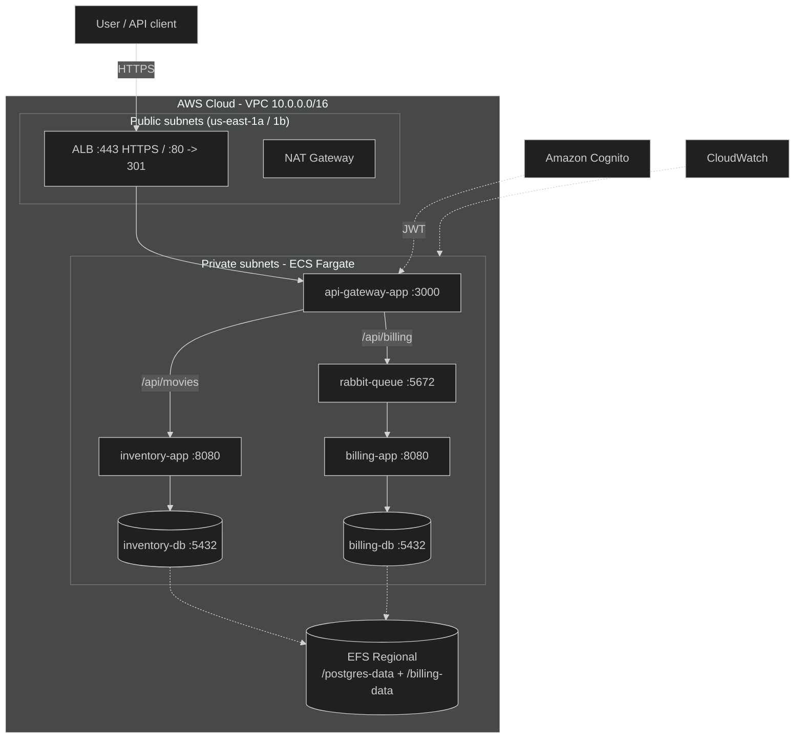

# Cloud-Design — Audit Study Guide

Everything you need to study and present for the audit, in one place.
Grounded in the live deployment (2026-09-12).

---

## 0. Live values (quick reference)

| Thing | Value |
|------|-------|
| AWS account / region | `006631837921` / `us-east-1` |
| ALB (app URL) | `https://cloud-design-alb-1584861693.us-east-1.elb.amazonaws.com` |
| ACM cert | `arn:aws:acm:us-east-1:006631837921:certificate/f338d135-0a61-42e8-9c96-def831540f89` |
| ECS cluster | `cloud-design-cluster` |
| Cognito pool / client | `us-east-1_aknmKaAQc` / `3cvtgrket91mshtv28mpriu301` |
| App images | `1ee5lim/{api-gateway-app,inventory-app,billing-app}:latest` |
| DB/Rabbit images | `oriax11/{inventory-db,billing-db,rabbit-queue}:latest` |
| Terraform resources | 73 managed instances |
| Terraform dir | `terraform/` (run commands from there) |

Handy shell setup:

```bash
export PATH="$HOME/.local/bin:$PATH"
cd ~/cloud-design/terraform
ALB=$(terraform output -raw alb_dns_name)
```

---

## 1. The 60-second pitch

"I deployed the microservices stack from the previous projects onto AWS with
Terraform. It's an **ECS Fargate** application across **two Availability Zones**
behind an **Application Load Balancer** with **HTTPS**. The **API gateway**
validates a **Cognito** JWT and routes to the **inventory** and **billing**
services; billing consumes from **RabbitMQ**. Each PostgreSQL database runs as a
container with its data persisted on a shared **EFS** file system. Everything is
observable in **CloudWatch**, the stateless services **auto-scale**, and the
whole stack costs about **$70 for 15 days**."

---

## 2. Architecture



**Request paths**

1. Client → **ALB** `:443` (TLS). `:80` redirects to HTTPS.
2. ALB → **api-gateway-app** `:3000` (private subnet, `awsvpc`).
3. Gateway validates the **Cognito JWT** on `/api/*`, then:
   - `GET/POST /api/movies` → **inventory-app** `:8080` → **inventory-db** `:5432`
   - `POST /api/billing/` → publishes to **rabbit-queue** `:5672`
4. **billing-app** consumes the queue → writes to **billing-db** `:5432`.
5. Both DBs persist on the shared **EFS**.

**Networking**

- VPC `10.0.0.0/16`; public `10.0.1.0/24` (1a) + `10.0.3.0/24` (1b);
  private `10.0.2.0/24` (1a) + `10.0.4.0/24` (1b).
- One **NAT Gateway** (AZ a) for outbound (image pulls); Internet Gateway for ingress.
- Private tasks have **no public IPs**.
- **ECS Service Connect** namespace `cloud-design` for service-to-service DNS.

---

## 3. Components & AWS services

| Component | Image | Port | Role |
|-----------|-------|------|------|
| api-gateway-app | `1ee5lim/api-gateway-app` | 3000 | Entry point; JWT auth; proxy/queue |
| inventory-app | `1ee5lim/inventory-app` | 8080 | Movies CRUD (PostgreSQL) |
| billing-app | `1ee5lim/billing-app` | 8080 | RabbitMQ consumer (PostgreSQL) |
| rabbit-queue | `oriax11/rabbit-queue` | 5672/15672 | Message broker |
| inventory-db | `oriax11/inventory-db` | 5432 | PostgreSQL |
| billing-db | `oriax11/billing-db` | 5432 | PostgreSQL |

AWS services: VPC, subnets, IGW, **NAT**, route tables, **security groups**,
**ECS Fargate**, **ECS Service Connect**, **EFS**, **ALB**, **ACM**,
**Cognito**, **Secrets Manager**, **CloudWatch** (Logs + Container Insights +
Dashboard), **IAM**, **AWS Budgets**. Registry: **Docker Hub**.

---

## 4. Subject requirements → implementation

| Requirement | Where |
|-------------|-------|
| 6 containers (2 DB :5432, 2 apps :8080, rabbit, gateway :3000) | 6 ECS task definitions (`terraform/modules/ecs/ecs_services.tf`) |
| Scalability | ECS Service Auto Scaling, 70% CPU, min 2 / max 4 |
| Availability | 2 AZs; stateless active-active; stateful single-active |
| Security | private subnets, SGs, TLS/ACM, Cognito, Secrets Manager, Trivy |
| Cost-effectiveness | ~$70/15d; single NAT; Docker Hub; right-sized Fargate |
| Simplicity | managed Fargate + Service Connect; one EFS |
| IaC (Terraform) | `terraform/` with 5 modules |
| Docker / optimized images | `srcs/` + `docker/`; `python:3.12-alpine` |
| Deployment + load balancing | ECS + ALB |
| Monitoring & logging | CloudWatch Logs + Container Insights + dashboard |
| Auto-scaling | target-tracking policies |
| HTTPS via ACM | self-signed cert imported, `:443` |
| Managed auth | Cognito user pool + JWKS JWT check |
| DBs only reachable from VPC | private subnets, no public IP, scoped SGs |
| README.md | `README.md` |

> Note: the subject mentions S3 only as an **example** ("or similar") for
> storage; the audit never mentions it. We use **EFS**.

---

## 5. Design decisions (the "why")

| Decision | Reason | Tradeoff |
|----------|--------|----------|
| **ECS over EKS** | no `$0.10/hr` control plane; audit uses `aws ecs` | less portable than k8s |
| **Fargate over EC2** | no host patching; each task gets its own ENI (no port clashes) | higher per-task cost |
| **2 AZs** | fault tolerance for the request tier; ALB + EFS span both | slightly more networking |
| **Single NAT** | halves NAT cost | outbound SPOF in AZ a (documented) |
| **Hybrid HA** | stateless active-active (2 replicas); DB/Rabbit single-active | DB has no live standby (RTO/RPO documented) |
| **One EFS + 2 access points** | cheaper/simpler than 2 file systems; isolates each DB | shared filesystem |
| **Service Connect** | service DNS without hardcoded IPs | AWS-specific |
| **Docker Hub** | free, no ECR setup | public images |
| **Self-signed ACM cert** | no owned domain to validate | browsers warn (`curl -k`) |
| **JWT validated in gateway** | clean `401` for API clients (ALB Cognito is browser/session based) | needs code in the image |
| **DBs as containers** | spec says "container"; saves ~$24/mo vs RDS | more manual persistence |

---

## 6. Security

- **Network isolation**: all tasks in private subnets; DBs have no public IP and
  are reachable only from the app SGs; single egress-only NAT.
- **Least-privilege SGs**: `alb → gateway → inventory → inventory-db`,
  `alb → gateway → rabbit`, `rabbit → billing → billing-db`; EFS allows NFS
  only from the DB SGs.
- **TLS**: ALB `:443` with ACM cert; `:80` → 301.
- **AuthN/Z**: Cognito user pool; gateway verifies the **RS256** JWT against the
  pool **JWKS** on every `/api/*` request → `401` otherwise.
- **Secrets**: all credentials in **Secrets Manager**, injected as task
  `secrets` (never in images or Terraform).
- **Encryption**: EFS encrypted at rest; TLS in transit.
- **Scanning**: **Trivy** scans in `monitoring/trivy-scan.txt`.

---

## 7. Cost (15 days, ~)

| Item | Est. |
|------|------|
| Fargate (9 tasks) | ~$42 |
| ALB + LCU | ~$10 |
| NAT Gateway | ~$16 |
| EFS | ~$1 |
| Misc | ~$1 |
| **Total** | **~$70** |

Optimizations: ECS vs EKS (~$18), 0.25 vCPU tasks, single NAT, one EFS, Docker
Hub, CloudWatch free tier. `AWS Budget cloud-design-monthly` ($50, 50/80/100%
alerts). Tear down with `scripts/cleanup.sh`.

---

## 8. Monitoring, logging, scaling

- **CloudWatch Logs**: one group per service (`/ecs/cloud-design-*`), `awslogs` driver.
- **Container Insights** enabled; dashboard `cloud-design` shows per-service
  CPU/memory, ALB request count, target response time, 5XX, running tasks.
- **Autoscaling**: target-tracking **70% CPU**, min 2 / max 4 for
  api-gateway/inventory/billing; DB/Rabbit fixed at 1. Verified **2 → 3** under load.

---

## 9. Repository / deliverables

```
README.md
docs/            subject, audit, plan, justification, audit-checklist, role-play-prep, this guide
srcs/            microservice source (gateway, inventory, billing, postgres-db, rabbitmq)
docker/          Dockerfiles + docker-compose.yml + .env.example
terraform/       provider, variables, outputs, main, budget + modules/{vpc,security,efs,alb,ecs}
ecs/task-definitions/   exported task definitions
monitoring/      cloudwatch-dashboard.json, trivy-scan.txt, load-test.txt
scripts/         bootstrap-iam, create-test-user, build-push, scan, load-test, deploy, cleanup
```

---

## 10. Audit walkthrough (checkpoint → do this → say this)

### 10.1 Repository content
- **Show**: `ls` the tree; open `README.md`, `srcs/`, `docker/`, `terraform/`.
- **Say**: documentation, source, containerization and IaC are all present.

### 10.2 Verify deployment (aws cli)
```bash
cd terraform
aws ecs list-services --cluster cloud-design-cluster
aws ecs describe-services --cluster cloud-design-cluster \
  --services cloud-design-api-gateway-service cloud-design-inventory-service \
  cloud-design-billing-service cloud-design-rabbit-queue \
  cloud-design-inventory-db cloud-design-billing-db \
  --query 'services[].{name:serviceName,desired:desiredCount,running:runningCount}'
```
- **Expect**: 6 services, stateless 2/2, stateful 1/1.
- `docker ps` is N/A on Fargate; use `docker compose ps` locally (docker-compose.yml).

### 10.3 Load balancing
```bash
aws elbv2 describe-target-groups --names cloud-design-app --query 'TargetGroups[0].TargetGroupArn' --output text
# then:
aws elbv2 describe-target-health --target-group-arn <arn>
```
- **Expect**: 2 targets healthy.

### 10.4 HTTPS
```bash
curl -kI https://$ALB/            # 200
curl -I  http://$ALB/             # 301 -> https
```

### 10.5 API through the gateway (needs token)
```bash
POOL=$(aws cognito-idp list-user-pools --max-results 10 --query 'UserPools[?Name==`cloud-design-user-pool`].Id' --output text)
CLIENT=$(aws cognito-idp list-user-pool-clients --user-pool-id $POOL --query 'UserPoolClients[0].ClientId' --output text)
TOKEN=$(./scripts/create-test-user.sh | tail -1)

curl -k https://$ALB/api/movies -H "Authorization: Bearer $TOKEN"          # 200
curl -k -X POST https://$ALB/api/movies -H "Authorization: Bearer $TOKEN" \
  -H 'Content-Type: application/json' \
  -d '{"title":"Demo","description":"audit","release_year":2026,"genre":"x"}' # 201
curl -k https://$ALB/api/movies -H "Authorization: Bearer $TOKEN"          # lists it
```

### 10.6 Auth rejection
```bash
curl -k https://$ALB/api/movies        # 401 (no token)
curl -k https://$ALB/api/movies -H "Authorization: Bearer bad.token"  # 401
```

### 10.7 Billing resilience
```bash
# allow scale to 0 and stop billing
aws application-autoscaling register-scalable-target --service-namespace ecs \
  --resource-id service/cloud-design-cluster/cloud-design-billing-service \
  --scalable-dimension ecs:service:DesiredCount --min-capacity 0 --max-capacity 4
aws ecs update-service --cluster cloud-design-cluster \
  --service cloud-design-billing-service --desired-count 0

# send a billing request (queued)
curl -k -X POST https://$ALB/api/billing/ -H "Authorization: Bearer $TOKEN" \
  -H 'Content-Type: application/json' \
  -d '{"user_id":1,"number_of_items":2,"total_amount":9.99}'   # 200

# restart billing + restore min
aws ecs update-service --cluster cloud-design-cluster \
  --service cloud-design-billing-service --desired-count 2
aws application-autoscaling register-scalable-target --service-namespace ecs \
  --resource-id service/cloud-design-cluster/cloud-design-billing-service \
  --scalable-dimension ecs:service:DesiredCount --min-capacity 2 --max-capacity 4
# verify the row landed in billing-db (see 10.9)
```
- **Say**: the message sits in RabbitMQ while the consumer is down, then is
  processed after restart.

### 10.8 Terraform
```bash
cd terraform
terraform plan        # No changes
terraform validate    # Success
```
- **Say**: plan/apply are how the whole environment is provisioned; 73 resources.

### 10.9 Inspect the databases (optional, strong evidence)
```bash
CL=cloud-design-cluster
BID=$(basename "$(aws ecs list-tasks --cluster $CL --service-name cloud-design-billing-db --query 'taskArns[0]' --output text)")
aws ecs execute-command --cluster $CL --task $BID --container billing-db --interactive \
  --command "sh -c 'PGPASSWORD=\$DB_PASSWORD psql -h 127.0.0.1 -U \$DB_USER -d \$DB_NAME -P pager=off -A -c \"SELECT * FROM orders;\"'"
# same pattern for inventory-db: SELECT * FROM movies;
```

### 10.10 Monitoring
- Open the **CloudWatch dashboard `cloud-design`**; show CPU/memory, ALB
  latency/5XX, running tasks. Show a log group (`/ecs/cloud-design-*`).

### 10.11 Security scanning
- Open `monitoring/trivy-scan.txt`: app images pass (no CRITICAL); DB images
  flagged (Debian base) with the remediation note.

---

## 11. Live demo runbook (do it in this order)

1. `terraform plan` → No changes (IaC).
2. `aws ecs describe-services ...` → all running.
3. `aws elbv2 describe-target-health` → 2 healthy.
4. `curl -k https://$ALB/` → 200 ; `curl http://$ALB/` → 301.
5. `curl -k https://$ALB/api/movies` → 401 (rejected).
6. Get token (`scripts/create-test-user.sh`).
7. `GET /api/movies` → 200; `POST /api/movies` → 201; `GET` shows it.
8. `POST /api/billing/` → 200; then show the `orders` row.
9. (Optional) billing resilience sequence (10.7).
10. Show the CloudWatch dashboard.
11. Close with cost + cleanup (`scripts/cleanup.sh`).

---

## 12. Role-play Q&A (short answers)

Full versions in `docs/role-play-prep.md`. One-liners:

1. **Cloud?** On-demand pay-per-use AWS services; elasticity, no capex, managed.
2. **Why cloud vs on-prem?** Speed, cost, elasticity, multi-AZ HA, managed security.
3. **Public/private/hybrid?** Shared vs dedicated vs mix; we're public with a VPC boundary.
4. **Why AWS?** Breadth of managed services, mature Terraform, tooling; region `us-east-1`.
5. **Architecture?** ALB→gateway(Cognito)→inventory/rabbit; billing consumes; DBs on EFS; Service Connect; 2 AZs.
6. **Cost?** ECS not EKS, 0.25 vCPU tasks, single NAT, one EFS, Docker Hub, budget alerts; ~$70/15d.
7. **Security?** Private subnets, SGs, TLS/ACM, Cognito JWT, Secrets Manager, encrypted EFS, Trivy.
8. **Monitoring?** CloudWatch Logs + Container Insights + dashboard; used to find the 500s and the scale trigger.
9. **Autoscaling?** Target-tracking 70% CPU, min2/max4; scaled 2→3 under load.
10. **Docker optimization?** `python:3.12-alpine`, deps before source for cache, `--no-cache-dir`.
11. **Redo?** Source in-repo from day one, auth/DB fixes in images, RDS/cluster for stateful HA, CI + Trivy.
12. **Future/migration?** Add a task def + Service Connect entry; Terraform + 12-factor images are portable.
13. **Challenges?** Hop-by-hop headers, stale DB connections, health-check path, single-writer DB — all fixed/documented.
14. **Docs quality?** README + `docs/` + Mermaid diagrams + `audit-checklist` + this guide + code-as-docs.

---

## 13. Challenges faced & fixes (great stories to tell)

| Challenge | Symptom | Root cause | Fix |
|-----------|---------|-----------|-----|
| Gateway 500s | intermittent 500 on API | image forwarded hop-by-hop `Connection` header, waitress rejects | strip upstream headers in `proxy.py`, rebuild image |
| Intermittent inventory 500s | `SSL SYSCALL error: EOF detected` | idle DB connections dropped via Service Connect | SQLAlchemy `pool_pre_ping` + `pool_recycle` |
| ALB targets unhealthy / task churn | `ResponseCodeMismatch` | default health check `/` returned 404 | added `/` route; health check on `/` |
| DB writer conflict | two DBs on shared storage | two writers corrupt data | single-active DBs + one access point each |
| Health check via proxy | health checker 500 | auth applied to `/`, health path needed to be unauthenticated | keep `/` public, protect `/api/*` |

---

## 14. Command cheat sheet

```bash
# setup
export PATH="$HOME/.local/bin:$PATH"; cd ~/cloud-design/terraform
ALB=$(terraform output -raw alb_dns_name)

# terraform
terraform validate && terraform plan

# ECS
aws ecs list-services --cluster cloud-design-cluster
aws ecs describe-services --cluster cloud-design-cluster --services <svc>
aws ecs describe-tasks --cluster cloud-design-cluster --tasks <task>
aws ecs list-tasks --cluster cloud-design-cluster --service-name <svc>

# ALB
aws elbv2 describe-target-health --target-group-arn <arn>
aws elbv2 describe-listeners --load-balancer-arn <arn>

# API
curl -k https://$ALB/
curl -k https://$ALB/api/movies -H "Authorization: Bearer $TOKEN"

# tokens
./scripts/create-test-user.sh          # pool/client auto-discovered; prints IdToken

# logs
aws logs describe-log-groups --log-group-name-prefix /ecs/cloud-design
aws logs get-log-events --log-group-name /ecs/cloud-design-api-gateway --log-stream-name <stream>

# cleanup
./scripts/cleanup.sh
```

---

## 15. Likely follow-up questions

- **Why not Kubernetes/EKS?** Cost + simplicity; ECS meets every audit check.
- **Why not RDS?** Spec says the DBs are containers; saves ~$24/mo; EFS gives persistence.
- **Is the DB highly available?** The *storage* is multi-AZ (EFS Regional); the
  DB *process* is single-active by design — documented RTO/RPO, with RDS
  Multi-AZ / streaming replication as the future improvement.
- **What if an AZ fails?** ALB and stateless replicas keep serving; the active
  stateful task may need recreation (documented).
- **Is the app secure?** HTTPS, Cognito JWT, private DBs, least-privilege SGs,
  secrets in Secrets Manager; scanned with Trivy.
- **How do services find each other?** ECS Service Connect DNS.
- **How is state managed?** Local Terraform state now; remote backend is a noted
  improvement.
- **What's left?** Rebuild the DB images on a maintained base to clear the Debian
  vulnerability backlog (documented in `monitoring/trivy-scan.txt`).
